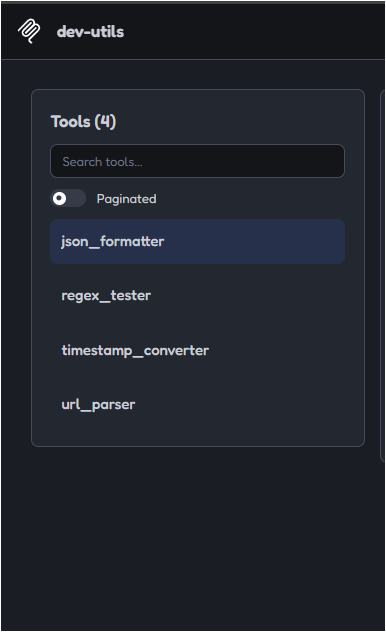
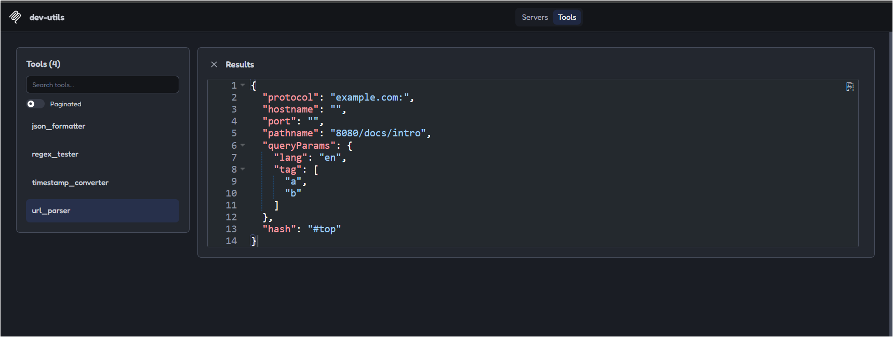

# Dev Tools MCP Server

A collection of developer utilities built with **TypeScript, Node.js, and the Model Context Protocol (MCP)**. This server allows compatible AI clients to use common developer tools through MCP.

##  Features

The server currently provides four tools:

| Tool | Description |
|---|---|
| `json_formatter` | Format and validate JSON with customizable indentation. |
| `regex_tester` | Test regular expressions against text and inspect matches. |
| `timestamp_converter` | Convert Unix timestamps into readable dates and times. |
| `url_parser` | Parse URLs into components, including query parameters. |

##  Tech Stack

- TypeScript
- Node.js
- Model Context Protocol (MCP)
- Zod for input validation
- MCP Inspector for testing

##  Screenshots

### MCP Inspector

View and test the available developer tools through MCP Inspector.



### Tool Execution

Example of executing a tool and inspecting its output.



> **Note:** Add your actual screenshots at the paths shown above for these images to appear.

##  Getting Started

### Prerequisites

- Node.js installed
- npm installed

### 1. Clone the repository

```bash
git clone https://github.com/Parthwebde12/dev-tools-mcp.git
cd dev-tools-mcp
```

### 2. Install dependencies

```bash
npm install
```

### 3. Build the project

```bash
npm run build
```

### 4. Run the server

```bash
npm start
```

The server communicates over **standard input/output (stdio)**, so it is designed to be launched by an MCP-compatible client.

##  Testing with MCP Inspector

Build the project first:

```bash
npm run build
```

Then launch MCP Inspector:

```bash
npm run inspect
```

Use the Inspector interface to connect to the server, explore the available tools, provide input, and check their responses.

##  Project Structure

```text
dev-tools-mcp/
├── src/
│   ├── tools/
│   │   ├── jsonFormatter.ts
│   │   ├── regexTester.ts
│   │   ├── timestampConverter.ts
│   │   └── urlParser.ts
│   ├── helpers.ts
│   └── index.ts
├── build/
├── package.json
├── package-lock.json
├── tsconfig.json
└── README.md
```

##  Purpose

This project explores how to build an MCP server that exposes reusable developer utilities to AI applications. It also provides practical experience with tool registration, input validation, error handling, and stdio-based communication.

##  Future Improvements

- Add more developer utilities.
- Improve automated testing.
- Add examples for connecting compatible MCP clients.
- Expand documentation with real execution examples.

